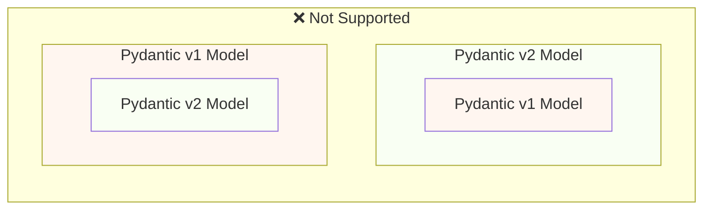
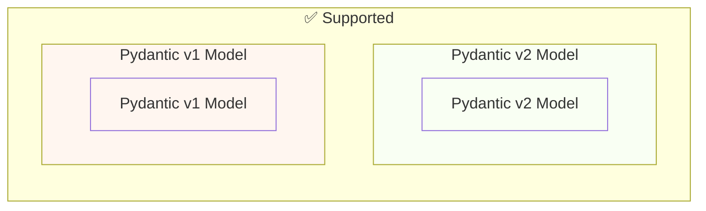

# Pydantic v1 থেকে Pydantic v2-তে স্থানান্তর { #migrate-from-pydantic-v1-to-pydantic-v2 }

/// note | এই পেজে যা শিখবেন

* কোন FastAPI সংস্করণ Pydantic-এর কোন সংস্করণ সাপোর্ট করে।
* `bump-pydantic` দিয়ে প্রায় স্বয়ংক্রিয়ভাবে কোড আপডেট করা।
* `pydantic.v1` কী, আর পুরনো FastAPI সংস্করণে ধাপে ধাপে স্থানান্তর কীভাবে হতো।

///

যদি আপনার একটি পুরনো FastAPI অ্যাপ থাকে, তাহলে হয়তো আপনি Pydantic সংস্করণ 1 ব্যবহার করছেন।

FastAPI সংস্করণ 0.100.0 Pydantic v1 বা v2 দুটোই সাপোর্ট করত। যেটি ইনস্টল করা থাকত সেটিই ব্যবহার করত।

FastAPI সংস্করণ 0.119.0 v2-তে স্থানান্তর সহজ করতে Pydantic v2-এর ভেতর থেকে Pydantic v1-এর (`pydantic.v1` হিসেবে) আংশিক সাপোর্ট চালু করে।

FastAPI 0.126.0 Pydantic v1-এর সাপোর্ট বাদ দেয়, তবে আরও কিছুদিন `pydantic.v1` সাপোর্ট রাখে।

FastAPI 0.128.0 `pydantic.v1`-এর সাপোর্টও বাদ দেয়, তাই FastAPI-এর সর্বশেষ সংস্করণগুলোতে Pydantic v2 লাগে।

/// info | এক নজরে সময়রেখা

| FastAPI সংস্করণ | Pydantic সাপোর্ট |
| --- | --- |
| 0.100.0 – 0.118.x | v1 অথবা v2, যেটি ইনস্টল করা আছে |
| 0.119.0 – 0.125.x | v1, v2, আর v2-এর ভেতরে `pydantic.v1` |
| 0.126.0 – 0.127.x | শুধু v2 (সাথে অস্থায়ীভাবে `pydantic.v1`) |
| 0.128.0 ও পরে | শুধু v2 |

///

/// warning | সতর্কতা

Pydantic দল Python-এর সর্বশেষ সংস্করণগুলোর জন্য, **Python 3.14** থেকে শুরু করে, Pydantic v1-এর সাপোর্ট বন্ধ করে দিয়েছে।

এর মধ্যে `pydantic.v1`-ও আছে, যা Python 3.14 ও তার পরে আর সাপোর্টেড নয়।

যদি Python-এর সর্বশেষ ফিচার ব্যবহার করতে চান, তাহলে নিশ্চিত করতে হবে যে আপনি Pydantic v2 ব্যবহার করছেন।

///

যদি আপনার Pydantic v1-সহ একটি পুরনো FastAPI অ্যাপ থাকে, এখানে দেখাব কীভাবে এটি Pydantic v2-তে স্থানান্তর করবেন, আর ধাপে ধাপে স্থানান্তরে সাহায্যের জন্য **FastAPI 0.119.0-এর ফিচারগুলো**।

## অফিসিয়াল গাইড { #official-guide }

Pydantic-এর v1 থেকে v2-তে যাওয়ার একটি অফিসিয়াল [Migration Guide](https://pydantic.dev/docs/validation/latest/get-started/migration/) আছে।

এতে আরও আছে কী কী বদলেছে, যাচাই এখন কীভাবে আরও সঠিক আর কঠোর, সম্ভাব্য সতর্কতা, ইত্যাদি।

কী বদলেছে তা ভালোভাবে বুঝতে এটি পড়তে পারেন।

## টেস্ট { #tests }

নিশ্চিত করুন যে আপনার অ্যাপের জন্য [টেস্ট](../tutorial/testing.md) আছে আর আপনি সেগুলো continuous integration-এ (CI, অর্থাৎ প্রতিবার কোড পুশ করলে স্বয়ংক্রিয়ভাবে টেস্ট চলা) চালান।

এভাবে আপনি আপগ্রেড করে নিশ্চিত হতে পারবেন যে সবকিছু এখনো প্রত্যাশামতো কাজ করছে।

## `bump-pydantic` { #bump-pydantic }

অনেক ক্ষেত্রে, যখন কোনো বিশেষ পরিবর্তন ছাড়া সাধারণ Pydantic মডেল ব্যবহার করেন, তখন Pydantic v1 থেকে Pydantic v2-তে স্থানান্তরের বেশিরভাগ প্রক্রিয়া স্বয়ংক্রিয় করতে পারবেন।

একই Pydantic দলের তৈরি [`bump-pydantic`](https://github.com/pydantic/bump-pydantic) ব্যবহার করতে পারেন।

এই টুল আপনাকে বদলাতে হবে এমন বেশিরভাগ কোড স্বয়ংক্রিয়ভাবে বদলাতে সাহায্য করবে।

এরপর টেস্ট চালিয়ে দেখতে পারেন সব কাজ করছে কিনা। করলে, আপনার কাজ শেষ। 😎

/// tip | উদাহরণ দিয়ে বুঝি

`bump-pydantic` অনেকটা মোবাইলের "সব অ্যাপ আপডেট করুন" বোতামের মতো: পুরনো লেখার ধরন (যেমন `.dict()`) খুঁজে নতুন ধরনে (`.model_dump()`) বদলে দেয়। তারপর টেস্ট চালিয়ে দেখে নিন কিছু ভেঙেছে কিনা।

///

## v2-এর ভেতরে Pydantic v1 { #pydantic-v1-in-v2 }

Pydantic v2-এ Pydantic v1-এর সবকিছু একটি সাবমডিউল `pydantic.v1` হিসেবে আছে। কিন্তু Python 3.13-এর ওপরের সংস্করণগুলোতে এটি আর সাপোর্টেড নয়।

এর মানে আপনি Pydantic v2-এর সর্বশেষ সংস্করণ ইনস্টল করে এই সাবমডিউল থেকে পুরনো Pydantic v1-এর কম্পোনেন্টগুলো ইমপোর্ট আর ব্যবহার করতে পারেন, যেন আপনার কাছে পুরনো Pydantic v1 ইনস্টল করা আছে।

{* ../../docs_src/pydantic_v1_in_v2/tutorial001_an_py310.py hl[1,4] *}

/// info | কোডটি সহজ ভাষায়

* লাইন ১: সাধারণ `from pydantic import BaseModel`-এর বদলে `from pydantic.v1 import BaseModel`। এতে Pydantic v2 ইনস্টল থাকলেও পুরনো v1-এর আচরণ পাওয়া যায়।
* লাইন ৪–৭: মডেলটি আগের মতোই লেখা।

///

### v2-এর ভেতরে Pydantic v1-এর জন্য FastAPI সাপোর্ট { #fastapi-support-for-pydantic-v1-in-v2 }

/// warning | সতর্কতা

`pydantic.v1` মডেলের জন্য FastAPI-এর এই সাপোর্ট যোগ করা হয়েছিল **FastAPI 0.119.0**-এ আর সরানো হয়েছে **FastAPI 0.128.0**-এ। এটি Pydantic v2-তে স্থানান্তরের জন্য একটি অস্থায়ী সহায়তা হিসেবে তৈরি করা হয়েছিল।

FastAPI-এর বর্তমান সংস্করণগুলোতে আপনার অ্যাপে একটি `pydantic.v1` মডেল ব্যবহার করলে এরর হবে।

এই অংশের বাকিটা শুধু সেই পুরনো সংস্করণগুলোতে পাওয়া অস্থায়ী সাপোর্ট বর্ণনা করে।

///

FastAPI 0.119.0 থেকে, v2-তে স্থানান্তর সহজ করতে Pydantic v2-এর ভেতর থেকে Pydantic v1-এর আংশিক সাপোর্টও আছে।

তাই আপনি Pydantic সর্বশেষ সংস্করণ 2-তে আপগ্রেড করে, `pydantic.v1` সাবমডিউল ব্যবহার করতে ইমপোর্টগুলো বদলাতে পারতেন, আর অনেক ক্ষেত্রে এটি এমনিতেই কাজ করত।

{* ../../docs_src/pydantic_v1_in_v2/tutorial002_an_py310.py hl[2,5,15] *}

/// warning | সতর্কতা

মনে রাখবেন, যেহেতু Pydantic দল Python-এর সাম্প্রতিক সংস্করণে, Python 3.14 থেকে, Pydantic v1 আর সাপোর্ট করে না, তাই `pydantic.v1` ব্যবহারও Python 3.14 ও তার পরে সাপোর্টেড নয়।

///

### একই অ্যাপে Pydantic v1 এবং v2 { #pydantic-v1-and-v2-on-the-same-app }

Pydantic v2-এর একটি মডেলের নিজস্ব ফিল্ড Pydantic v1 মডেল হিসেবে সংজ্ঞায়িত করা, বা উল্টোটা, Pydantic **সাপোর্ট করে না**।

...কিন্তু একই অ্যাপে আলাদা আলাদা মডেল রাখতে পারেন, কিছু Pydantic v1 ব্যবহার করে আর অন্যগুলো Pydantic v2।

কিছু ক্ষেত্রে, আপনার FastAPI অ্যাপের একই **পাথ অপারেশনে** Pydantic v1 আর v2 দুটো মডেলই রাখা সম্ভব:

{* ../../docs_src/pydantic_v1_in_v2/tutorial003_an_py310.py hl[2:3,6,12,21:22] *}

ওপরের এই উদাহরণে, ইনপুট মডেলটি একটি Pydantic v1 মডেল, আর আউটপুট মডেলটি (`response_model=ItemV2`-এ সংজ্ঞায়িত) একটি Pydantic v2 মডেল।

/// info | কোডটি সহজ ভাষায়

* লাইন ২: v2-এর `BaseModel`-কে `BaseModelV2` নামে ইমপোর্ট, যাতে নামে সংঘর্ষ না হয়।
* লাইন ৩: v1-এর `BaseModel` ইমপোর্ট।
* লাইন ৬ আর ১২: `Item` হলো v1 মডেল, `ItemV2` হলো v2 মডেল।
* লাইন ২১–২২: ইনপুট `item: Item` (v1), আউটপুট `response_model=ItemV2` (v2)।

///

### Pydantic v1 প্যারামিটার { #pydantic-v1-parameters }

যদি Pydantic v1 মডেলের সাথে `Body`, `Query`, `Form` ইত্যাদির মতো FastAPI-নির্দিষ্ট প্যারামিটার টুল ব্যবহার করতে হয়, তাহলে Pydantic v2-তে স্থানান্তর শেষ করার সময় পর্যন্ত এগুলো `fastapi.temp_pydantic_v1_params` থেকে ইমপোর্ট করতে পারেন:

{* ../../docs_src/pydantic_v1_in_v2/tutorial004_an_py310.py hl[4,18] *}

### ধাপে ধাপে স্থানান্তর { #migrate-in-steps }

/// warning | সতর্কতা

নিচে বর্ণিত একই অ্যাপে Pydantic v1 আর v2 দুটো মডেল ব্যবহার করে ধাপে ধাপে স্থানান্তর শুধু **FastAPI 0.119.0 থেকে 0.127.x**-এ কাজ করে। এটি **FastAPI 0.128.0**-এ সরানো হয়েছে, সর্বশেষ সংস্করণগুলোতে **Pydantic v2** মডেল লাগে।

///

/// tip | পরামর্শ

প্রথমে `bump-pydantic` দিয়ে চেষ্টা করুন, যদি আপনার টেস্ট পাস করে আর এটি কাজ করে, তাহলে এক কমান্ডেই কাজ শেষ। ✨

///

যদি `bump-pydantic` আপনার ক্ষেত্রে কাজ না করে, তাহলে Pydantic v2-তে ধীরে ধীরে স্থানান্তর করতে একই অ্যাপে Pydantic v1 আর v2 দুটো মডেলের সাপোর্ট ব্যবহার করতে পারেন।

প্রথমে Pydantic সর্বশেষ সংস্করণ 2-তে আপগ্রেড করে আপনার সব মডেলের জন্য `pydantic.v1` ব্যবহার করতে ইমপোর্টগুলো বদলাতে পারেন।

তারপর, আপনার মডেলগুলো দলে দলে, ধীরে ধীরে Pydantic v1 থেকে v2-তে স্থানান্তর শুরু করতে পারেন। 🚶

/// check | সংক্ষেপে মনে রাখুন

* FastAPI-এর সর্বশেষ সংস্করণে শুধু Pydantic v2 চলে, আর Python 3.14+-এ v1 একেবারেই চলে না।
* প্রথম পদক্ষেপ: টেস্ট লিখুন, তারপর `bump-pydantic` চালান, তারপর টেস্ট চালান।
* বড়, জটিল প্রজেক্টে FastAPI 0.119–0.127 ব্যবহার করে `pydantic.v1` দিয়ে ধাপে ধাপে মডেল বদলানো যেত, তারপর সর্বশেষ FastAPI-তে যাওয়া।

///
