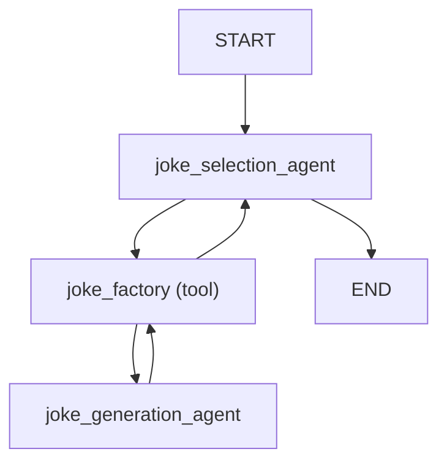
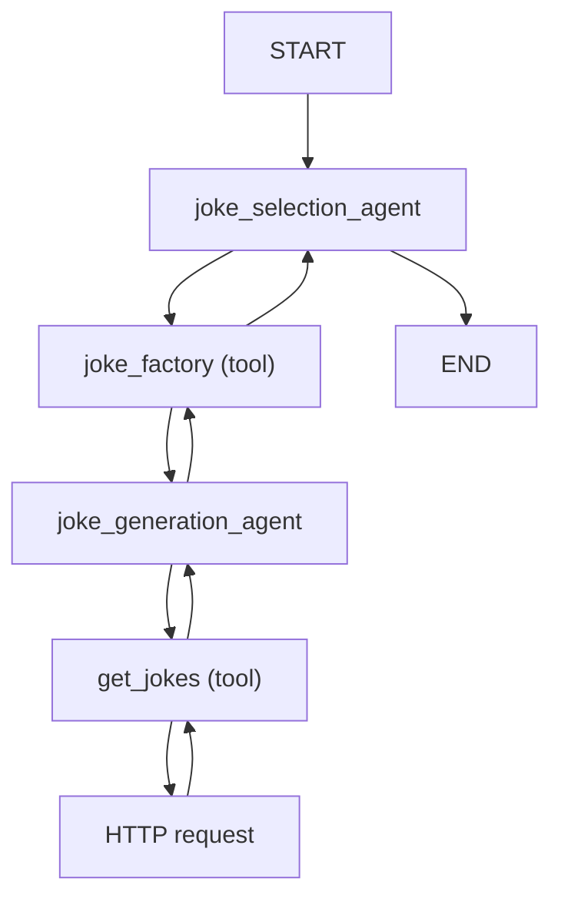
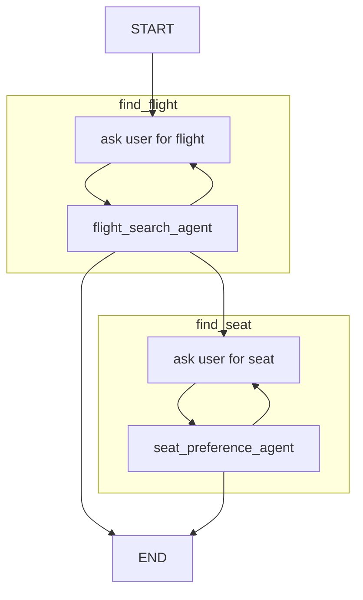

# বহু-এজেন্ট অ্যাপ্লিকেশন { #multi-agent-applications }

/// note | এই পেজে যা শিখবেন

* একাধিক এজেন্ট মিলে কাজ করানোর পাঁচটি স্তর।
* Agent delegation: একটি এজেন্ট টুলের ভেতর থেকে আরেকটিকে কাজ দেয়, তারপর নিয়ন্ত্রণ ফিরে পায়।
* Programmatic hand-off: আপনার কোড ঠিক করে পরের কোন এজেন্ট চলবে।
* Deep agent, আর Logfire দিয়ে বহু-এজেন্ট সিস্টেম পর্যবেক্ষণ।

///

Pydantic AI দিয়ে অ্যাপ্লিকেশন তৈরিতে মোটামুটি পাঁচটি জটিলতার স্তর আছে:

1. একক এজেন্টের workflow — `pydantic_ai` ডকুমেন্টেশনের বেশিরভাগ যা নিয়ে
2. [Agent delegation](#agent-delegation) — এজেন্ট টুলের মাধ্যমে আরেকটি এজেন্ট ব্যবহার করে, হাতে জোড়া লাগিয়ে বা Harness-এর [`SubAgents`](harness/subagents.md) capability দিয়ে
3. [Programmatic agent hand-off](#programmatic-agent-hand-off) — একটি এজেন্ট চলে, তারপর অ্যাপ্লিকেশনের কোড আরেকটি এজেন্ট ডাকে
4. [Graph-ভিত্তিক নিয়ন্ত্রণ-প্রবাহ](graph.md) — সবচেয়ে জটিল ক্ষেত্রে, একাধিক এজেন্টের চলা নিয়ন্ত্রণে একটি graph-ভিত্তিক state machine ব্যবহার করা যায়
5. [Deep Agents](#deep-agents) — পরিকল্পনা, ফাইলের কাজ, কাজ অর্পণ আর sandbox-এ কোড চালানোসহ স্বাধীন এজেন্ট

অবশ্যই, একটি অ্যাপ্লিকেশনে একাধিক কৌশল মেলাতে পারেন।

/// tip | উদাহরণ দিয়ে বুঝি

একটি অফিস ভাবুন। **Delegation**: ম্যানেজার (parent এজেন্ট) একজন বিশেষজ্ঞকে (delegate) একটি কাজ দিলেন, বিশেষজ্ঞ ফল ফেরত দিলেন, ম্যানেজার বাকিটা সামলালেন। **Hand-off**: রিসেপশন (প্রথম এজেন্ট) আপনার তথ্য নিয়ে আপনাকে বিলিং কাউন্টারে (দ্বিতীয় এজেন্ট) পাঠিয়ে দিল — কে কোথায় যাবে তা অফিসের নিয়ম (আপনার কোড) ঠিক করে। **Graph**: পুরো অফিসের একটি ফ্লোচার্ট, কোন অবস্থায় কোন টেবিলে যেতে হবে।

///

## Agent delegation { #agent-delegation }

"Agent delegation" বলতে সেই পরিস্থিতি বোঝায় যেখানে একটি এজেন্ট আরেকটি এজেন্টকে কাজ দেয়, তারপর delegate এজেন্ট (একটি টুলের ভেতর থেকে ডাকা এজেন্ট) শেষ করলে নিয়ন্ত্রণ ফিরে নেয়।
প্রথম এজেন্টে আর না ফিরে নিয়ন্ত্রণ পুরোপুরি আরেকটি এজেন্টের হাতে দিতে চাইলে, একটি [আউটপুট ফাংশন](output.md#output-functions) ব্যবহার করতে পারেন।

/// tip | `SubAgents` এটি আপনার হয়ে করে

[Pydantic AI Harness](harness/index.md)-এ একটি [`SubAgents`](harness/subagents.md) capability আছে, যা কাজ অর্পণের সবচেয়ে সুবিধাজনক উপায়: আপনি এটিকে নামসহ এজেন্টের একটি তালিকা দেন আর এটি একটি একক `delegate_task(agent_name, task)` টুল দেখায়, dependencies পাঠায়, usage সীমা বয়ে নেয়, আর উপলব্ধ delegate-দের system prompt-এ একটি স্থির নির্দেশনা হিসেবে তালিকা করে, যাতে তালিকাটি cache-যোগ্য prefix-এ থাকে (দেখুন [prompt caching](models/anthropic.md#prompt-caching))। প্রতিটি অর্পণ নিজের বার্তার ইতিহাসসহ নিজের রানে চলে, তাই একটি delegate কখনো parent কথোপকথন দেখে না।

`SubAgents` যে নিয়ন্ত্রণ দেয় না তা দরকার হলে — একটি নিজের মতো টুল schema, প্রতি-delegate আর্গুমেন্ট যাচাই, বা parent-এর বার্তার ইতিহাস পাঠানো — নিচের মতো হাতে অর্পণের টুল লিখুন।

///

যেহেতু এজেন্ট stateless আর global হিসেবে নকশা করা, এজেন্টের [dependencies](dependencies.md)-এ এজেন্টটিকেই রাখার দরকার নেই।

সাধারণত আপনি [`ctx.usage`][pydantic_ai.tools.RunContext.usage] delegate এজেন্ট রানের [`usage`][pydantic_ai.agent.AbstractAgent.run] keyword আর্গুমেন্টে দিতে চাইবেন, যাতে সেই রানের usage parent এজেন্ট রানের মোট usage-এ গোনা হয়।

[Cancellation](agent.md#cancellation-and-sub-agents) রান-ভিত্তিক: একটি delegate এজেন্ট নিজেকে বাতিল করলে তা parent-কে বাতিল না করে parent-এর কাছে একটি ব্যর্থ টুল ফল হিসেবে দেখা দেয়, আর একটি ভাগ করা [`CancellationToken`][pydantic_ai.CancellationToken] একসাথে রানের পুরো গাছ বাতিল করে।

/// note | একাধিক মডেল

Agent delegation-এ প্রতিটি এজেন্টের একই মডেল ব্যবহার করার দরকার নেই। একটি রানের মধ্যে ভিন্ন মডেল বাছলে, চূড়ান্ত [`result.usage`][pydantic_ai.agent.AgentRunResult.usage] তবুও হিসাব করা যায় এমন প্রতি-উত্তরের খরচ জমা করে। তবে মোট token সংখ্যা থেকে টাকার খরচ পুনর্গঠন করা যায় না, কারণ মডেলগুলোর দাম আলাদা হতে পারে। অপ্রত্যাশিত খরচ বা নিয়ন্ত্রণহীন টুল loop এড়াতে [`UsageLimits`][pydantic_ai.usage.UsageLimits] ব্যবহার করতে পারেন — `cost_limit`, `request_limit`, `total_tokens_limit` আর `tool_calls_limit`-সহ।

///

```python title="agent_delegation_simple.py"
from pydantic_ai import Agent, RunContext, UsageLimits

joke_selection_agent = Agent(  # (1)!
    'openai:gpt-6.1-sol',
    name='joke_selection_agent',  # (2)!
    instructions=(
        'Use the `joke_factory` to generate some jokes, then choose the best. '
        'You must return just a single joke.'
    ),
)
joke_generation_agent = Agent(  # (3)!
    'google:gemini-3.8-flash', name='joke_generation_agent', output_type=list[str]
)


@joke_selection_agent.tool
async def joke_factory(ctx: RunContext, count: int) -> list[str]:
    r = await joke_generation_agent.run(  # (4)!
        f'Please generate {count} jokes.',
        usage=ctx.usage,  # (5)!
    )
    return r.output  # (6)!


result = joke_selection_agent.run_sync(
    'Tell me a joke.',
    usage_limits=UsageLimits(request_limit=5, total_tokens_limit=500),
)
print(result.output)
#> Did you hear about the toothpaste scandal? They called it Colgate.
print(result.usage)
"""
RunUsage(
    cost=Decimal('0.00047625'),
    input_tokens=165,
    output_tokens=24,
    requests=3,
    tool_calls=1,
)
"""
```

1. "parent" বা নিয়ন্ত্রক এজেন্ট।
2. `name` দেওয়া ঐচ্ছিক, তবে একাধিক এজেন্ট চালালে প্রস্তাবিত: এটি প্রতিটি এজেন্টের রান span-এ লেবেল দেয়, তাই দুটোর নাম দিলে [Logfire](logfire.md)-এ parent আর delegate আলাদা করে চেনা যায়। বাদ দিলে, এজেন্টটি যে ভ্যারিয়েবলে assign করা হয়েছে তা থেকে নাম অনুমান হয়, আর তা না গেলে `'agent'` হয় (যেমন একটি তালিকা বা dict-এ রাখা এজেন্ট)।
3. "delegate" এজেন্ট, যা parent এজেন্টের একটি টুলের ভেতর থেকে ডাকা হয়।
4. parent এজেন্টের একটি টুলের ভেতর থেকে delegate এজেন্ট ডাকুন।
5. parent এজেন্টের usage delegate এজেন্টকে দিন, যাতে চূড়ান্ত [`result.usage`][pydantic_ai.agent.AgentRunResult.usage]-এ দুই এজেন্টের usage থাকে।
6. যেহেতু ফাংশনটি `#!python list[str]` ফেরত দেয়, আর `joke_generation_agent`-এর `output_type`-ও `#!python list[str]`, তাই টুল থেকে সরাসরি `#!python r.output` ফেরত দিতে পারি।

_(এই উদাহরণ সম্পূর্ণ, "যেমন আছে তেমন" চালানো যায়)_

/// warning | sync নয়, একটি `async def` ফাংশন থেকে কাজ অর্পণ করুন

লক্ষ্য করুন, ওপরের `joke_factory` হলো `async def` আর `await joke_generation_agent.run(...)` ব্যবহার করে। এটি বাধ্যতামূলক, শৈলী নয়: [`run_sync()`][pydantic_ai.agent.AbstractAgent.run_sync] আর [`run_stream_sync()`][pydantic_ai.agent.AbstractAgent.run_stream_sync] একটি টুল, [আউটপুট ফাংশন](output.md#output-functions), বা একটি এজেন্ট রানের সময় ডাকা অন্য কোনো ফাংশনের ভেতরে ব্যবহার করা যায় না, আর সেখানে [`UserError`][pydantic_ai.exceptions.UserError] তোলে।

parent এজেন্ট তবুও `run_sync()` দিয়ে শুরু করা যায়, যেমন ওপরের উদাহরণে; শুধু কাজ-অর্পণকারী ফাংশনটিকে `async def` হতে হবে। এর blocking কাজও করতে হলে, এটিকে `async def` রেখে শুধু সেই অংশটি [`asyncio.to_thread()`][asyncio.to_thread]-এ পাঠান।

///

/// note | একটি Temporal workflow-এর ভেতরে কাজ অর্পণ

একটি [Temporal](durable_execution/temporal.md) activity-তে চলা একটি টুল রানের context-এর একটি কপি পায়, তাই `usage=ctx.usage` delegate-এর usage parent রানে ফেরত বয়ে আনে না। দেখুন [Agent Run Context and Dependencies](durable_execution/temporal.md#agent-run-context-and-dependencies)।

///

এই উদাহরণের নিয়ন্ত্রণ-প্রবাহ বেশ সরল আর এভাবে সংক্ষেপ করা যায়:



### Agent delegation আর dependencies { #agent-delegation-and-dependencies }

সাধারণত delegate এজেন্টের হয় ডাকা এজেন্টের মতোই [dependencies](dependencies.md) থাকা দরকার, নয়তো এমন dependencies যা ডাকা এজেন্টের dependencies-এর একটি উপসেট।

/// info | Dependencies শুরু করা

ওপরে আমরা "সাধারণত" বলছি কারণ একটি টুল কলের ভেতরে dependencies শুরু করা, আর তাই একটি delegate এজেন্টে এমন dependencies ব্যবহার করা যা parent-এ নেই, তাতে কোনো বাধা নেই; তবে এটি প্রায়ই এড়ানো উচিত, কারণ parent এজেন্টের সংযোগ ইত্যাদি আবার ব্যবহারের চেয়ে এটি উল্লেখযোগ্যভাবে ধীর হতে পারে।

///

```python title="agent_delegation_deps.py"
from dataclasses import dataclass

import httpx

from pydantic_ai import Agent, RunContext


@dataclass
class ClientAndKey:  # (1)!
    http_client: httpx.AsyncClient
    api_key: str


joke_selection_agent = Agent(
    'openai:gpt-6.1-sol',
    name='joke_selection_agent',
    deps_type=ClientAndKey,  # (2)!
    instructions=(
        'Use the `joke_factory` tool to generate some jokes on the given subject, '
        'then choose the best. You must return just a single joke.'
    ),
)
joke_generation_agent = Agent(
    'google:gemini-3.8-flash',
    name='joke_generation_agent',
    deps_type=ClientAndKey,  # (4)!
    output_type=list[str],
    instructions=(
        'Use the "get_jokes" tool to get some jokes on the given subject, '
        'then extract each joke into a list.'
    ),
)


@joke_selection_agent.tool
async def joke_factory(ctx: RunContext[ClientAndKey], count: int) -> list[str]:
    r = await joke_generation_agent.run(
        f'Please generate {count} jokes.',
        deps=ctx.deps,  # (3)!
        usage=ctx.usage,
    )
    return r.output


@joke_generation_agent.tool  # (5)!
async def get_jokes(ctx: RunContext[ClientAndKey], count: int) -> str:
    response = await ctx.deps.http_client.get(
        'https://example.com',
        params={'count': count},
        headers={'Authorization': f'Bearer {ctx.deps.api_key}'},
    )
    response.raise_for_status()
    return response.text


async def main():
    async with httpx.AsyncClient() as client:
        deps = ClientAndKey(client, 'foobar')
        result = await joke_selection_agent.run('Tell me a joke.', deps=deps)
        print(result.output)
        #> Did you hear about the toothpaste scandal? They called it Colgate.
        print(result.usage)  # (6)!
        """
        RunUsage(
            cost=Decimal('0.00054750'),
            input_tokens=220,
            output_tokens=32,
            requests=4,
            tool_calls=2,
        )
        """
```

1. client আর API key dependencies রাখতে একটি dataclass সংজ্ঞায়িত করুন।
2. ডাকা এজেন্টের `deps_type` সেট করুন — এখানে `joke_selection_agent`।
3. টুল কলের ভেতরে delegate এজেন্টের রান মেথডে dependencies দিন।
4. delegate এজেন্টেরও `deps_type` সেট করুন — এখানে `joke_generation_agent`।
5. delegate এজেন্টে একটি টুল সংজ্ঞায়িত করুন, যা dependencies দিয়ে একটি HTTP রিকোয়েস্ট করে।
6. Usage-এ এখন 4টি রিকোয়েস্ট — 2টি ডাকা এজেন্টের আর 2টি delegate এজেন্টের।

_(এই উদাহরণ চালাতে, নিশ্চিত করুন `asyncio` import করা আছে আর `asyncio.run(main())` যোগ করুন; আর কোনো পরিবর্তন লাগবে না।)_

এই উদাহরণ দেখায় একটি মোটামুটি সরল agent delegation-ও কীভাবে জটিল নিয়ন্ত্রণ-প্রবাহে পৌঁছাতে পারে:



## Programmatic agent hand-off { #programmatic-agent-hand-off }

"Programmatic agent hand-off" বলতে সেই পরিস্থিতি বোঝায় যেখানে একাধিক এজেন্ট পরপর ডাকা হয়, আর পরের কোন এজেন্ট ডাকা হবে তা ঠিক করার দায়িত্ব অ্যাপ্লিকেশনের কোড আর/বা লুপে থাকা একজন মানুষের।

এখানে এজেন্টদের একই deps ব্যবহার করার দরকার নেই।

/// tip | এজেন্টদের মধ্যে বার্তার ইতিহাস

আরেকটি এজেন্টকে আগের কথোপকথন প্রসঙ্গ হিসেবে দিতে, তার রান মেথডে
`message_history` দিন। নির্দেশনা, system prompt আর টুল-প্রসঙ্গের বিস্তারিত জানতে দেখুন
[Sharing messages between agents](message-history.md#sharing-messages-between-agents)।

///

এখানে আমরা পরপর ব্যবহৃত দুটি এজেন্ট দেখাই, প্রথমটি একটি ফ্লাইট খোঁজে আর দ্বিতীয়টি ব্যবহারকারীর আসনের পছন্দ বের করে।

```python title="programmatic_handoff.py"
from typing import Literal

from pydantic import BaseModel, Field
from rich.prompt import Prompt

from pydantic_ai import Agent, ModelMessage, RunContext, RunUsage, UsageLimits


class FlightDetails(BaseModel):
    flight_number: str


class Failed(BaseModel):
    """Unable to find a satisfactory choice."""


flight_search_agent = Agent[object, FlightDetails | Failed](  # (1)!
    'openai:gpt-6.1-sol',
    name='flight_search_agent',
    output_type=FlightDetails | Failed,
    instructions=(
        'Use the "flight_search" tool to find a flight '
        'from the given origin to the given destination.'
    ),
)


@flight_search_agent.tool  # (2)!
async def flight_search(
    ctx: RunContext, origin: str, destination: str
) -> FlightDetails | None:
    # in reality, this would call a flight search API or
    # use a browser to scrape a flight search website
    return FlightDetails(flight_number='AK456')


usage_limits = UsageLimits(request_limit=15)  # (3)!


async def find_flight(usage: RunUsage) -> FlightDetails | None:  # (4)!
    message_history: list[ModelMessage] | None = None
    for _ in range(3):
        prompt = Prompt.ask(
            'Where would you like to fly from and to?',
        )
        result = await flight_search_agent.run(
            prompt,
            message_history=message_history,
            usage=usage,
            usage_limits=usage_limits,
        )
        if isinstance(result.output, FlightDetails):
            return result.output
        else:
            message_history = result.all_messages(
                output_tool_return_content='Please try again.'
            )


class SeatPreference(BaseModel):
    row: int = Field(ge=1, le=30)
    seat: Literal['A', 'B', 'C', 'D', 'E', 'F']


# This agent is responsible for extracting the user's seat selection
seat_preference_agent = Agent[object, SeatPreference | Failed](  # (5)!
    'openai:gpt-6.1-sol',
    name='seat_preference_agent',
    output_type=SeatPreference | Failed,
    instructions=(
        "Extract the user's seat preference. "
        'Seats A and F are window seats. '
        'Row 1 is the front row and has extra leg room. '
        'Rows 14, and 20 also have extra leg room. '
    ),
)


async def find_seat(usage: RunUsage) -> SeatPreference:  # (6)!
    message_history: list[ModelMessage] | None = None
    while True:
        answer = Prompt.ask('What seat would you like?')

        result = await seat_preference_agent.run(
            answer,
            message_history=message_history,
            usage=usage,
            usage_limits=usage_limits,
        )
        if isinstance(result.output, SeatPreference):
            return result.output
        else:
            print('Could not understand seat preference. Please try again.')
            message_history = result.all_messages()


async def main():  # (7)!
    usage: RunUsage = RunUsage()

    opt_flight_details = await find_flight(usage)
    if opt_flight_details is not None:
        print(f'Flight found: {opt_flight_details.flight_number}')
        #> Flight found: AK456
        seat_preference = await find_seat(usage)
        print(f'Seat preference: {seat_preference}')
        #> Seat preference: row=1 seat='A'
```

1. প্রথম এজেন্ট সংজ্ঞায়িত করুন, যা একটি ফ্লাইট খোঁজে। [PEP-747](https://peps.python.org/pep-0747/) আসা পর্যন্ত আমরা একটি স্পষ্ট type annotation ব্যবহার করি, দেখুন [structured output](output.md#structured-output)। আমরা আউটপুট টাইপ হিসেবে একটি union ব্যবহার করি, যাতে মডেল জানাতে পারে সন্তোষজনক বিকল্প খুঁজে না পেলে; ভেতরে, union-এর প্রতিটি সদস্য আলাদা টুল হিসেবে নথিভুক্ত হবে।
2. ফ্লাইট খুঁজতে এজেন্টে একটি টুল সংজ্ঞায়িত করুন। এই সরল ক্ষেত্রে টুলটি বাদ দিয়ে শুধু এজেন্টকে গোছানো ডেটা ফেরত দিতে বলে, তারপর ফ্লাইট খুঁজতে পারতাম, কিন্তু আরও জটিল পরিস্থিতিতে টুলটি দরকার হতো।
3. পুরো অ্যাপের usage সীমা সংজ্ঞায়িত করুন।
4. একটি ফ্লাইট খোঁজার ফাংশন সংজ্ঞায়িত করুন, যা ব্যবহারকারীর পছন্দ জিজ্ঞেস করে তারপর ফ্লাইট খুঁজতে এজেন্টটি ডাকে।
5. ওপরের `flight_search_agent`-এর মতো, এজেন্ট সংজ্ঞায়িত করতে আমরা একটি স্পষ্ট type annotation ব্যবহার করি।
6. ব্যবহারকারীর আসনের পছন্দ খোঁজার একটি ফাংশন সংজ্ঞায়িত করুন, যা ব্যবহারকারীকে আসনের পছন্দ জিজ্ঞেস করে তারপর পছন্দটি বের করতে এজেন্টটি ডাকে।
7. প্রতিটি এজেন্ট চালানোর লজিক আলাদা ফাংশনে রাখার পরে, আমাদের প্রধান অ্যাপ খুব সরল হয়ে যায়।

_(এই উদাহরণ চালাতে, নিশ্চিত করুন `asyncio` import করা আছে আর `asyncio.run(main())` যোগ করুন; আর কোনো পরিবর্তন লাগবে না।)_

এই উদাহরণের নিয়ন্ত্রণ-প্রবাহ এভাবে সংক্ষেপ করা যায়:



/// info | Delegation বনাম hand-off, এক নজরে

| | Delegation | Programmatic hand-off |
| --- | --- | --- |
| কে পরের এজেন্ট ডাকে | parent এজেন্ট (মডেল), একটি টুলের মাধ্যমে | আপনার Python কোড |
| নিয়ন্ত্রণ কোথায় ফেরে | parent এজেন্টে | আপনার কোডে |
| deps | সাধারণত একই বা উপসেট | যার যা দরকার |
| কখন | মডেল নিজে ঠিক করুক কখন সাহায্য লাগবে | ধাপগুলো আগে থেকেই জানা |

///

## Pydantic Graphs { #pydantic-graphs }

কখন আর কীভাবে graph ব্যবহার করবেন তা জানতে [graph](graph.md) ডকুমেন্টেশন দেখুন।

## Deep Agents { #deep-agents }

Deep agent হলো স্বাধীন এজেন্ট, যারা জটিল, বহু-ধাপের কাজ নির্ভরযোগ্যভাবে সামলাতে একাধিক স্থাপত্য-ধরন আর capability মেলায়। [Pydantic AI Harness](harness/index.md) এই ধরনগুলোর প্রতিটি একটি capability হিসেবে দেয়, যা আপনি Pydantic AI-এর built-in সুবিধার সাথে জুড়তে পারেন:

- **পরিকল্পনা আর অগ্রগতি ট্র্যাক করা** — এজেন্ট জটিল কাজ ধাপে ভাঙে আর তাদের অগ্রগতি ট্র্যাক করে, এজেন্ট কী নিয়ে কাজ করছে তা ব্যবহারকারীকে দেখিয়ে। দেখুন [`Planning`](harness/planning.md)।
- **File system-এর কাজ** — রানের workspace-এ ফাইল পড়া, লেখা আর সম্পাদনা, লোকাল মেশিনে বা একটি sandbox container-এ। দেখুন [`FileSystem`](harness/filesystem.md) আর [`Shell`](harness/shell.md)।
- **কাজ অর্পণ** — নির্দিষ্ট কাজের জন্য বিশেষায়িত sub-agent তৈরি করা, পুনরাবৃত্ত অর্পণের সমস্যা এড়াতে বিচ্ছিন্ন প্রসঙ্গসহ। দেখুন [`SubAgents`](harness/subagents.md) আর ওপরের [Agent Delegation](#agent-delegation)।
- **Sandbox-এ কোড চালানো** — দুর্ঘটনা এড়াতে AI-এর তৈরি কোড বিচ্ছিন্ন পরিবেশে চালানো। দেখুন একটি sandbox backend-সহ [`Shell`](harness/shell.md), যেমন [`DockerSandbox`](harness/docker-sandbox.md), আর [`CodeMode`](harness/code-mode.md)।
- **প্রসঙ্গ ব্যবস্থাপনা** — দীর্ঘ session, যা অন্যথায় token সীমা পেরোত, সামলাতে কথোপকথনের স্বয়ংক্রিয় compaction। দেখুন [Compaction](capabilities/compaction.md) আর Harness-এর [compaction strategies](harness/compaction.md)।
- **Human-in-the-loop** — কোড চালানো বা ফাইল মোছার মতো বিপজ্জনক কাজের অনুমোদন-প্রবাহ। দেখুন [Requiring Tool Approval](toolsets.md#requiring-tool-approval)।
- **Durable execution** — সাময়িক API ব্যর্থতা আর অ্যাপ্লিকেশনের এরর বা পুনরায় চালু হওয়া-জুড়ে এজেন্টের অবস্থা রক্ষা করা। দেখুন [Durable Execution](durable_execution/overview.md)।

এই টুকরোগুলোর একটি তৈরি সমাবেশের জন্য, [`Coder`](harness/coder.md) file system, shell, অর্পণ আর প্রসঙ্গ ব্যবস্থাপনার capability মিলিয়ে একটি কোডিং এজেন্ট বানায়, যা পুরোটা ব্যবহার করতে বা খুলে আলাদা করতে পারেন।

## বহু-এজেন্ট সিস্টেম পর্যবেক্ষণ { #observing-multi-agent-systems }

জটিলতার কারণে বহু-এজেন্ট সিস্টেম debug করা কঠিন হতে পারে; একাধিক এজেন্ট আদান-প্রদান করলে, চলার প্রবাহ বোঝা অপরিহার্য হয়ে ওঠে।

### Agent delegation trace করা { #tracing-agent-delegation }

[Logfire](logfire.md) দিয়ে, একাধিক এজেন্ট-জুড়ে পুরো প্রবাহ trace করতে পারেন:

```python
import logfire

logfire.configure()
logfire.instrument_pydantic_ai()

# Your multi-agent code here...
```

Logfire আপনাকে দেখায়:

- রিকোয়েস্টের **কোন অংশ কোন এজেন্ট সামলেছে**
- **অর্পণের সিদ্ধান্ত**—কখন আর কেন একটি এজেন্ট আরেকটিকে ডেকেছে
- এজেন্ট অনুযায়ী ভাগ করা **শুরু থেকে শেষ পর্যন্ত দেরি**
- প্রতি এজেন্টে **token usage আর খরচ**
- **কী এজেন্ট রান শুরু করেছে**—HTTP রিকোয়েস্ট, নির্ধারিত job, বা ব্যবহারকারীর কাজ যা সব শুরু করেছে
- **টুল কলের ভেতরে কী ঘটেছে**—ডেটাবেস query, HTTP রিকোয়েস্ট, ফাইলের কাজ, আর টুলের চালানো অন্য যেকোনো instrument করা কোড

জটিল এজেন্ট workflow বোঝা আর উন্নত করতে এটি অপরিহার্য। একটি বহু-এজেন্ট সিস্টেমে কিছু ভুল হলে, ঠিক কোন এজেন্ট ব্যর্থ হয়েছে আর সে কী করার চেষ্টা করছিল, আর সমস্যাটি এজেন্টের যুক্তিতে নাকি তার ডাকা backend সিস্টেমে ছিল, তা দেখতে পাবেন।

### পুরো stack-এর দৃশ্যমানতা { #full-stack-visibility }

আপনার Pydantic AI অ্যাপ্লিকেশনে একটি TypeScript frontend, API gateway, বা অন্য ভাষার সার্ভিস থাকলে, Logfire সেগুলোও trace করতে পারে—Logfire Python, JavaScript/TypeScript আর Rust-এর SDK দেয়, সাথে যেকোনো OpenTelemetry-instrument করা অ্যাপ্লিকেশনের সামঞ্জস্য। আপনার পুরো stack-এর trace একটি একীভূত দৃশ্যে দেখুন। সাধারণ OpenTelemetry দিয়ে অন্য ভাষা থেকে ডেটা পাঠানোর বিস্তারিত জানতে দেখুন [alternative clients guide](https://logfire.pydantic.dev/docs/how-to-guides/alternative-clients/)।

Pydantic AI-এর instrumentation [OpenTelemetry](https://opentelemetry.io/)-র ওপর তৈরি, তাই যেকোনো OTel-সামঞ্জস্যপূর্ণ backend-ও ব্যবহার করতে পারেন। বিস্তারিত জানতে দেখুন [Logfire integration guide](logfire.md)।

## উদাহরণ { #examples }

নিচের উদাহরণগুলো দেখায় Pydantic AI-তে বহু-এজেন্ট ধরন কীভাবে ব্যবহার করবেন:

- [Flight booking](examples/flight-booking.md)

/// check | সংক্ষেপে মনে রাখুন

* Delegation: parent এজেন্টের একটি `async def` টুলের ভেতরে `await delegate.run(..., usage=ctx.usage)`; ফল টুল থেকে ফেরত দিন।
* টুলের ভেতরে কখনো `run_sync()` নয়।
* বেশি সুবিধার জন্য Harness-এর `SubAgents` capability।
* Hand-off: আপনার কোড পরপর এজেন্ট ডাকে; প্রসঙ্গ দিতে `message_history`।
* খরচ নিয়ন্ত্রণে সব এজেন্টে একই `UsageLimits`; পর্যবেক্ষণে Logfire আর প্রতিটি এজেন্টে `name=`।

///
