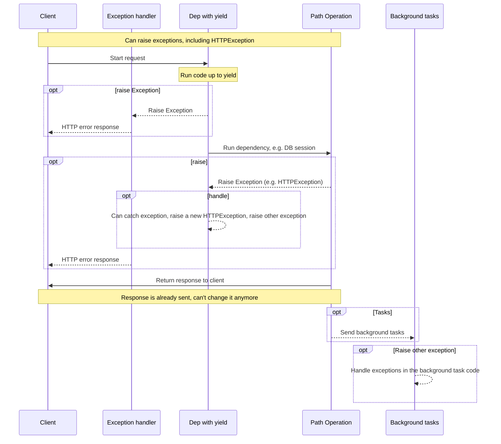
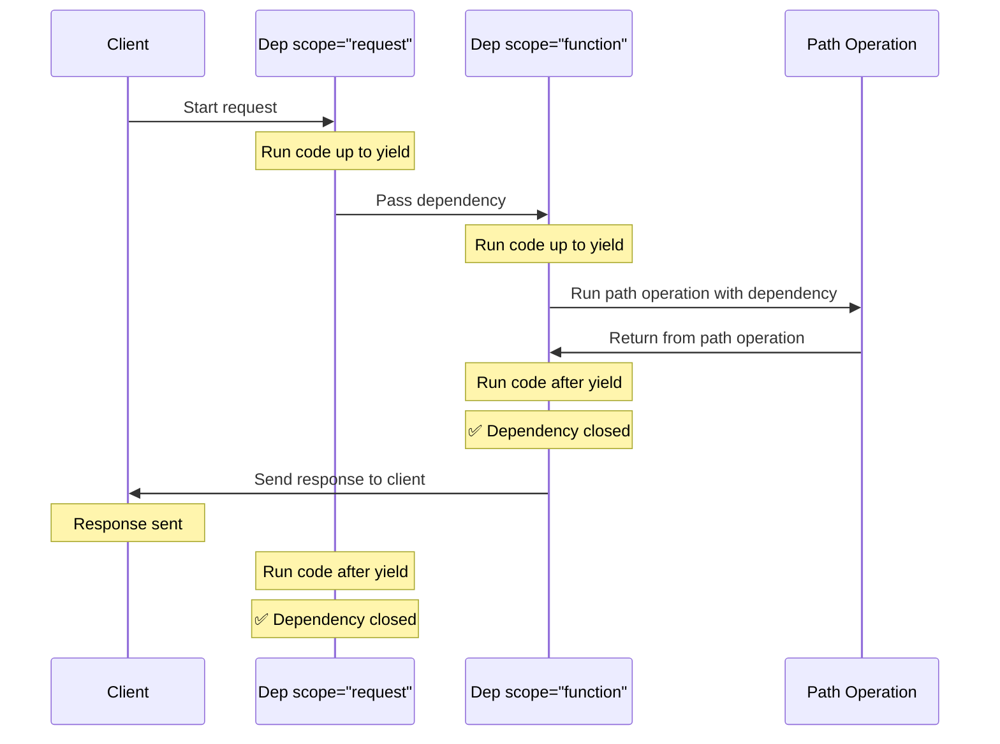

# `yield`-সহ ডিপেন্ডেন্সি { #dependencies-with-yield }

/// note | এই পেজে যা শিখবেন

* কাজ শেষে "পরিষ্কার করার" কোড (যেমন ডেটাবেস সংযোগ বন্ধ করা) চালাতে `yield` ব্যবহার।
* `try` / `finally` দিয়ে এরর হলেও পরিষ্কারের কোড নিশ্চিত করা।
* একাধিক `yield` ডিপেন্ডেন্সি কোন ক্রমে খোলে আর বন্ধ হয়।
* `except` ব্যবহারের সময় কেন অবশ্যই আবার `raise` করতে হবে।
* `scope="function"` দিয়ে রেসপন্স পাঠানোর আগেই পরিষ্কার করা।

///

FastAPI এমন ডিপেন্ডেন্সি সাপোর্ট করে, যেগুলো <dfn title='কখনো কখনো "exit code", "cleanup code", "teardown code", "closing code", "context manager exit code" ইত্যাদিও বলা হয়'>কাজ শেষ হওয়ার পরে কিছু বাড়তি ধাপ</dfn> সম্পন্ন করে।

এটি করতে `return`-এর বদলে `yield` ব্যবহার করুন, আর বাড়তি ধাপগুলো (কোড) এর পরে লিখুন।

/// tip | উদাহরণ দিয়ে বুঝি

লাইব্রেরি থেকে বই ধার নেওয়ার কথা ভাবুন:

1. লাইব্রেরিয়ান বইটি বের করে দেন (`yield`-এর আগের কোড: সংযোগ খোলা)।
2. আপনি বইটি পড়েন (আপনার পাথ অপারেশন বইটি ব্যবহার করে)।
3. পড়া শেষে বইটি ফেরত দিয়ে তাকে রাখা হয় (`yield`-এর পরের কোড: সংযোগ বন্ধ করা)।

`return` দিলে শুধু ধাপ ১ হতো, বই আর ফেরত আসত না। `yield` নিশ্চিত করে যে ধাপ ৩-ও হবে।

///

/// tip | পরামর্শ

প্রতিটি ডিপেন্ডেন্সিতে `yield` কেবল একবারই ব্যবহার করবেন।

///

/// note | কারিগরি বিবরণ

যেকোনো ফাংশন যা এগুলোর সাথে ব্যবহারের জন্য বৈধ:

* [`@contextlib.contextmanager`](https://docs.python.org/3/library/contextlib.html#contextlib.contextmanager) অথবা
* [`@contextlib.asynccontextmanager`](https://docs.python.org/3/library/contextlib.html#contextlib.asynccontextmanager)

তা একটি **FastAPI** ডিপেন্ডেন্সি হিসেবে ব্যবহারের জন্যও বৈধ।

আসলে FastAPI ভেতরে এই দুটি ডেকোরেটরই ব্যবহার করে।

///

## `yield`-সহ একটি ডেটাবেস ডিপেন্ডেন্সি { #a-database-dependency-with-yield }

যেমন, একটি ডেটাবেস সেশন তৈরি করে কাজ শেষে বন্ধ করতে এটি ব্যবহার করতে পারেন।

রেসপন্স তৈরির আগে কেবল `yield` স্টেটমেন্ট পর্যন্ত (এটিসহ) কোডটুকু চলে:

{* ../../docs_src/dependencies/tutorial007_py310.py hl[2:4] *}

`yield` করা মানটিই *পাথ অপারেশন* আর অন্য ডিপেন্ডেন্সিগুলোতে ইনজেক্ট করা হয়:

{* ../../docs_src/dependencies/tutorial007_py310.py hl[4] *}

`yield` স্টেটমেন্টের পরের কোড রেসপন্সের পরে চলে:

{* ../../docs_src/dependencies/tutorial007_py310.py hl[5:6] *}

/// info | কোডটি সহজ ভাষায়

* লাইন ২: `db = DBSession()`: ডেটাবেসের সাথে একটি সংযোগ (সেশন) খোলা।
* লাইন ৪: `yield db`: এই সংযোগটি পাথ অপারেশনকে দেওয়া হলো। এখানে ফাংশনটি "থেমে" থাকে।
* লাইন ৫-৬: `finally: db.close()`: পাথ অপারেশনের কাজ শেষ হলে (এরর হোক বা না হোক) সংযোগ বন্ধ করা হয়।

সংযোগ বন্ধ না করলে কিছুক্ষণ পরে ডেটাবেসের সংযোগ ফুরিয়ে যাবে আর অ্যাপ আটকে যাবে। তাই এই ধরনটা খুব জরুরি।

///

/// tip | পরামর্শ

`async` বা সাধারণ ফাংশন ব্যবহার করতে পারেন।

**FastAPI** সাধারণ ডিপেন্ডেন্সির মতোই প্রতিটির সাথে সঠিক কাজটি করবে।

///

## `yield` আর `try`-সহ একটি ডিপেন্ডেন্সি { #a-dependency-with-yield-and-try }

`yield`-সহ একটি ডিপেন্ডেন্সিতে `try` ব্লক ব্যবহার করলে, ডিপেন্ডেন্সিটি ব্যবহারের সময় ছোড়া যেকোনো এক্সেপশন আপনি পাবেন।

যেমন, মাঝখানে কোনো এক সময়ে কোনো কোড, অন্য কোনো ডিপেন্ডেন্সিতে বা একটি *পাথ অপারেশনে*, যদি একটি ডেটাবেস ট্রানজ্যাকশন "রোলব্যাক" (বাতিল) করে বা অন্য কোনো এক্সেপশন তৈরি করে, তাহলে আপনার ডিপেন্ডেন্সিতে আপনি সেই এক্সেপশনটি পাবেন।

তাই ডিপেন্ডেন্সির ভেতরে `except SomeException` দিয়ে সেই নির্দিষ্ট এক্সেপশনটি খুঁজতে পারেন।

একইভাবে, এক্সেপশন হোক বা না হোক, বের হওয়ার ধাপগুলো যে চলবেই তা নিশ্চিত করতে `finally` ব্যবহার করতে পারেন।

{* ../../docs_src/dependencies/tutorial007_py310.py hl[3,5] *}

## `yield`-সহ সাব-ডিপেন্ডেন্সি { #sub-dependencies-with-yield }

যেকোনো আকার ও ধরনের সাব-ডিপেন্ডেন্সি আর সাব-ডিপেন্ডেন্সির "গাছ" রাখতে পারেন, আর এদের যেকোনোটি বা সবগুলোই `yield` ব্যবহার করতে পারে।

**FastAPI** নিশ্চিত করবে যে `yield`-সহ প্রতিটি ডিপেন্ডেন্সির "বের হওয়ার কোড" সঠিক ক্রমে চলছে।

যেমন, `dependency_c` নির্ভর করতে পারে `dependency_b`-এর ওপর, আর `dependency_b` নির্ভর করতে পারে `dependency_a`-এর ওপর:

{* ../../docs_src/dependencies/tutorial008_an_py310.py hl[6,14,22] *}

আর এদের সবাই `yield` ব্যবহার করতে পারে।

এই ক্ষেত্রে `dependency_c`-এর বের হওয়ার কোড চালাতে `dependency_b`-এর মান (এখানে নাম `dep_b`) তখনও উপলব্ধ থাকতে হবে।

আর আবার, `dependency_b`-এর বের হওয়ার কোডের জন্য `dependency_a`-এর মান (এখানে নাম `dep_a`) উপলব্ধ থাকতে হবে।

{* ../../docs_src/dependencies/tutorial008_an_py310.py hl[18:19,26:27] *}

/// info | ক্রমটি সহজ ভাষায়

খোলার ক্রম: `a` → `b` → `c`। বন্ধ করার ক্রম উল্টো: `c` → `b` → `a`।

অনেকটা একটির ভেতরে আরেকটি বাক্স খোলার মতো: বাইরের বাক্স আগে খোলেন, ভেতরেরটা পরে। ভরার সময় ভেতরেরটা আগে বন্ধ করেন, তারপর বাইরেরটা। কারণ `c` বন্ধ করতে `b` লাগে, তাই `b` তখনও খোলা থাকতে হবে।

///

একইভাবে, কিছু ডিপেন্ডেন্সি `yield`-সহ আর কিছু অন্য ডিপেন্ডেন্সি `return`-সহ রাখতে পারেন, আর এদের কিছু অন্য কিছুর ওপর নির্ভর করতে পারে।

আর একটিমাত্র ডিপেন্ডেন্সি রাখতে পারেন যার `yield`-সহ আরও কয়েকটি ডিপেন্ডেন্সি দরকার, ইত্যাদি।

যে কোনো সংমিশ্রণে ডিপেন্ডেন্সি রাখতে পারেন।

**FastAPI** নিশ্চিত করবে যে সবকিছু সঠিক ক্রমে চলছে।

/// note | কারিগরি বিবরণ

এটি কাজ করে Python-এর [কনটেক্সট ম্যানেজারের](https://docs.python.org/3/library/contextlib.html) কল্যাণে।

**FastAPI** এটি অর্জন করতে ভেতরে সেগুলো ব্যবহার করে।

///

## `yield` আর `HTTPException`-সহ ডিপেন্ডেন্সি { #dependencies-with-yield-and-httpexception }

আপনি দেখলেন যে `yield`-সহ ডিপেন্ডেন্সি ব্যবহার করে `try` ব্লক রাখা যায়, যা কিছু কোড চালানোর চেষ্টা করে আর তারপর `finally`-র পরে কিছু বের হওয়ার কোড চালায়।

ছোড়া এক্সেপশনটি ধরে তা দিয়ে কিছু করতে `except`-ও ব্যবহার করতে পারেন।

যেমন, ভিন্ন একটি এক্সেপশন রেইজ করতে পারেন, যেমন `HTTPException`।

/// tip | পরামর্শ

এটি কিছুটা উন্নত কৌশল, আর বেশিরভাগ ক্ষেত্রে আপনার আসলে এটি দরকার হবে না, কারণ আপনার অ্যাপ্লিকেশনের বাকি কোডের ভেতর থেকেই, যেমন *পাথ অপারেশন ফাংশনে*, এক্সেপশন (`HTTPException`-সহ) রেইজ করতে পারেন।

তবে দরকার হলে এটি আছে। 🤓

///

{* ../../docs_src/dependencies/tutorial008b_an_py310.py hl[18:22,31] *}

/// info | কোডটি সহজ ভাষায়

* লাইন ১৮-২২: `get_username` ইউজারনেম `"Rick"` দেয়। পরে যদি কোথাও `OwnerError` হয়, সেটি ধরে ৪০০ স্ট্যাটাসের `HTTPException`-এ বদলে দেয়।
* লাইন ৩০-৩১: আইটেমের মালিক ইউজার না হলে `OwnerError` ছোড়া হয়।
* ফলে `/items/plumbus` (মালিক Morty) চাইলে ক্লায়েন্ট পায় `400 Owner error: Rick`।

///

এক্সেপশন ধরে তার ভিত্তিতে একটি কাস্টম রেসপন্স তৈরি করতে চাইলে একটি [কাস্টম এক্সেপশন হ্যান্ডলার](../handling-errors.md#install-custom-exception-handlers) তৈরি করুন।

## `yield` আর `except`-সহ ডিপেন্ডেন্সি { #dependencies-with-yield-and-except }

`yield`-সহ একটি ডিপেন্ডেন্সিতে `except` দিয়ে একটি এক্সেপশন ধরে যদি আবার রেইজ না করেন (বা নতুন একটি এক্সেপশন রেইজ না করেন), তাহলে FastAPI টেরই পাবে না যে একটি এক্সেপশন হয়েছিল, ঠিক সাধারণ Python-এ যেমনটা হয়:

{* ../../docs_src/dependencies/tutorial008c_an_py310.py hl[15:16] *}

এই ক্ষেত্রে ক্লায়েন্ট যথাযথভাবেই একটি *HTTP 500 Internal Server Error* রেসপন্স দেখবে, যেহেতু আমরা একটি `HTTPException` বা এরকম কিছু রেইজ করছি না, কিন্তু সার্ভারে এররটি কী ছিল তার **কোনো লগ** বা অন্য কোনো চিহ্ন **থাকবে না**। 😱

### `yield` আর `except`-সহ ডিপেন্ডেন্সিতে সবসময় `raise` করুন { #always-raise-in-dependencies-with-yield-and-except }

`yield`-সহ একটি ডিপেন্ডেন্সিতে একটি এক্সেপশন ধরলে, যদি না আপনি আরেকটি `HTTPException` বা এরকম কিছু রেইজ করছেন, **আপনার মূল এক্সেপশনটি আবার রেইজ করা উচিত**।

`raise` ব্যবহার করে একই এক্সেপশন আবার রেইজ করতে পারেন:

{* ../../docs_src/dependencies/tutorial008d_an_py310.py hl[17] *}

এখন ক্লায়েন্ট একই *HTTP 500 Internal Server Error* রেসপন্স পাবে, কিন্তু সার্ভারের লগে আমাদের কাস্টম `InternalError` থাকবে। 😎

/// warning | সাধারণ ভুল

এক্সেপশন ধরে শুধু `print` করে চুপ করে থাকা ("গিলে ফেলা")। এতে সমস্যা ঘটলেও লগে কিছু থাকে না, আর পরে খুঁজে বের করা খুব কঠিন হয়। `except`-এর শেষে শুধু `raise` লিখে দিলেই এররটি আবার ওপরে চলে যায়।

///

## `yield`-সহ ডিপেন্ডেন্সি চলার ক্রম { #execution-of-dependencies-with-yield }

চলার ক্রম মোটামুটি এই চিত্রের মতো। সময় ওপর থেকে নিচে বয়ে যায়। আর প্রতিটি কলাম হলো মিথস্ক্রিয়া করা বা কোড চালানো অংশগুলোর একটি।



/// note | নোট

ক্লায়েন্টকে কেবল **একটি রেসপন্স** পাঠানো হবে। এটি এরর রেসপন্সগুলোর একটি হতে পারে, অথবা *পাথ অপারেশনের* রেসপন্স হবে।

ওই রেসপন্সগুলোর একটি পাঠানোর পরে আর কোনো রেসপন্স পাঠানো যায় না।

///

/// tip | পরামর্শ

*পাথ অপারেশন ফাংশনের* কোডে যেকোনো এক্সেপশন রেইজ করলে, `HTTPException`-সহ, সেটি yield-ওয়ালা ডিপেন্ডেন্সিগুলোতে পাঠানো হবে। বেশিরভাগ ক্ষেত্রে আপনি `yield`-সহ ডিপেন্ডেন্সি থেকে সেই একই এক্সেপশন বা একটি নতুন এক্সেপশন আবার রেইজ করতে চাইবেন, যাতে এটি সঠিকভাবে সামলানো হয়।

///

## আগে বের হওয়া আর `scope` { #early-exit-and-scope }

সাধারণত `yield`-সহ ডিপেন্ডেন্সির বের হওয়ার কোড ক্লায়েন্টকে **রেসপন্স পাঠানোর পরে** চলে।

কিন্তু আপনি যদি জানেন যে *পাথ অপারেশন ফাংশন* থেকে ফেরার পরে ডিপেন্ডেন্সিটি আর ব্যবহার করবেন না, তাহলে `Depends(scope="function")` ব্যবহার করে FastAPI-কে বলতে পারেন যে *পাথ অপারেশন ফাংশন* ফিরে আসার পরে, কিন্তু **রেসপন্স পাঠানোর আগে**, ডিপেন্ডেন্সিটি বন্ধ করতে হবে।

{* ../../docs_src/dependencies/tutorial008e_an_py310.py hl[12,16] *}

`Depends()` একটি `scope` প্যারামিটার গ্রহণ করে, যা হতে পারে:

* `"function"`: রিকোয়েস্ট সামলানো *পাথ অপারেশন ফাংশনের* আগে ডিপেন্ডেন্সি শুরু, *পাথ অপারেশন ফাংশন* শেষ হওয়ার পরে কিন্তু ক্লায়েন্টকে রেসপন্স ফেরত পাঠানোর **আগে** ডিপেন্ডেন্সি শেষ। অর্থাৎ ডিপেন্ডেন্সি ফাংশনটি *পাথ অপারেশন **ফাংশনের*** **চারপাশে** চলবে।
* `"request"`: রিকোয়েস্ট সামলানো *পাথ অপারেশন ফাংশনের* আগে ডিপেন্ডেন্সি শুরু (`"function"` ব্যবহারের মতোই), কিন্তু ক্লায়েন্টকে রেসপন্স ফেরত পাঠানোর **পরে** শেষ। অর্থাৎ ডিপেন্ডেন্সি ফাংশনটি **রিকোয়েস্ট** আর রেসপন্স চক্রের **চারপাশে** চলবে।

নির্দিষ্ট না করলে আর ডিপেন্ডেন্সিতে `yield` থাকলে, এর ডিফল্ট `scope` হবে `"request"`।

/// tip | কখন কোনটি

* `"request"` (ডিফল্ট): রেসপন্স পাঠানোর সময়েও ডিপেন্ডেন্সির জিনিস লাগতে পারে, যেমন ডেটাবেস থেকে ধাপে ধাপে স্ট্রিম করা রেসপন্স।
* `"function"`: রেসপন্স তৈরি হয়ে গেলে আর দরকার নেই, তাই আগেভাগে সংযোগ বা রিসোর্স ছেড়ে দেওয়া ভালো।

///

### সাব-ডিপেন্ডেন্সির জন্য `scope` { #scope-for-sub-dependencies }

আপনি যখন `scope="request"` (ডিফল্ট) দিয়ে একটি ডিপেন্ডেন্সি ঘোষণা করেন, তখন যেকোনো সাব-ডিপেন্ডেন্সিরও `scope` `"request"` হতে হবে।

কিন্তু `scope` `"function"`-ওয়ালা একটি ডিপেন্ডেন্সির ডিপেন্ডেন্সিগুলোর `scope` `"function"` আর `"request"` দুটোই হতে পারে।

এর কারণ, যেকোনো ডিপেন্ডেন্সিকে তার সাব-ডিপেন্ডেন্সিগুলোর আগে নিজের বের হওয়ার কোড চালাতে পারতে হবে, কারণ বের হওয়ার কোডের সময় হয়তো তখনও সেগুলো ব্যবহার করতে হতে পারে।



## `yield`, `HTTPException`, `except` আর ব্যাকগ্রাউন্ড টাস্কসহ ডিপেন্ডেন্সি { #dependencies-with-yield-httpexception-except-and-background-tasks }

বিভিন্ন ব্যবহারের ক্ষেত্র সামলাতে আর কিছু সমস্যা ঠিক করতে `yield`-সহ ডিপেন্ডেন্সি সময়ের সাথে বিকশিত হয়েছে।

FastAPI-এর বিভিন্ন সংস্করণে কী কী বদলেছে তা দেখতে চাইলে অ্যাডভান্সড গাইডে [উন্নত ডিপেন্ডেন্সি - `yield`, `HTTPException`, `except` আর ব্যাকগ্রাউন্ড টাস্কসহ ডিপেন্ডেন্সি](../../advanced/advanced-dependencies.md#dependencies-with-yield-httpexception-except-and-background-tasks)-এ আরও পড়তে পারেন।

## কনটেক্সট ম্যানেজার { #context-managers }

### "কনটেক্সট ম্যানেজার" কী { #what-are-context-managers }

"কনটেক্সট ম্যানেজার" হলো সেইসব Python অবজেক্ট, যেগুলো একটি `with` স্টেটমেন্টে ব্যবহার করা যায়।

যেমন, [একটি ফাইল পড়তে `with` ব্যবহার করতে পারেন](https://docs.python.org/3/tutorial/inputoutput.html#reading-and-writing-files):

```Python
with open("./somefile.txt") as f:
    contents = f.read()
    print(contents)
```

ভেতরে ভেতরে `open("./somefile.txt")` একটি অবজেক্ট তৈরি করে, যাকে বলে "কনটেক্সট ম্যানেজার"।

`with` ব্লক শেষ হলে এটি নিশ্চিত করে যে ফাইলটি বন্ধ হচ্ছে, এক্সেপশন হলেও।

`yield`-সহ একটি ডিপেন্ডেন্সি তৈরি করলে **FastAPI** ভেতরে এর জন্য একটি কনটেক্সট ম্যানেজার তৈরি করে, আর সেটিকে আরও কিছু সম্পর্কিত টুলের সাথে মেলায়।

### `yield`-সহ ডিপেন্ডেন্সিতে কনটেক্সট ম্যানেজার ব্যবহার { #using-context-managers-in-dependencies-with-yield }

/// warning | সতর্কতা

এটি মোটামুটি একটি "উন্নত" ধারণা।

আপনি যদি সবে **FastAPI** শুরু করে থাকেন, তাহলে আপাতত এটি বাদ দিতে পারেন।

///

Python-এ [দুটি মেথড `__enter__()` আর `__exit__()`-সহ একটি ক্লাস তৈরি করে](https://docs.python.org/3/reference/datamodel.html#context-managers) কনটেক্সট ম্যানেজার তৈরি করা যায়।

ডিপেন্ডেন্সি ফাংশনের ভেতরে `with` বা `async with` স্টেটমেন্ট ব্যবহার করে
`yield`-সহ **FastAPI** ডিপেন্ডেন্সির ভেতরেও এগুলো ব্যবহার করতে পারেন:

{* ../../docs_src/dependencies/tutorial010_py310.py hl[1:9,13] *}

/// info | কোডটি সহজ ভাষায়

* `__enter__`: `with` ব্লকে ঢোকার সময় চলে, ডেটাবেস সেশন ফেরত দেয়।
* `__exit__`: `with` ব্লক থেকে বের হওয়ার সময় চলে (এরর হলেও), সেশন বন্ধ করে।
* `get_db`: `with` ব্লকের ভেতরে `yield db`, তাই পাথ অপারেশন শেষ হলে `with` থেকে বের হয়ে সেশন বন্ধ হয়।

///

/// tip | পরামর্শ

কনটেক্সট ম্যানেজার তৈরির আরেকটি উপায় হলো এগুলো দিয়ে:

* [`@contextlib.contextmanager`](https://docs.python.org/3/library/contextlib.html#contextlib.contextmanager) অথবা
* [`@contextlib.asynccontextmanager`](https://docs.python.org/3/library/contextlib.html#contextlib.asynccontextmanager)

একটিমাত্র `yield`-সহ একটি ফাংশন ডেকোরেট করা।

`yield`-সহ ডিপেন্ডেন্সির জন্য **FastAPI** ভেতরে এটিই ব্যবহার করে।

কিন্তু FastAPI ডিপেন্ডেন্সির জন্য আপনাকে এই ডেকোরেটরগুলো ব্যবহার করতে হবে না (আর করা উচিতও নয়)।

FastAPI ভেতরে আপনার হয়ে এটি করবে।

///

/// check | সংক্ষেপে মনে রাখুন

* `yield`-এর আগে: প্রস্তুতি (সংযোগ খোলা)। `yield`-এর মান: পাথ অপারেশন যা পায়। `yield`-এর পরে: পরিষ্কার (সংযোগ বন্ধ)।
* `try: yield ... finally: পরিষ্কার` লিখুন, যাতে এরর হলেও পরিষ্কার হয়।
* `except` দিয়ে এরর ধরলে শেষে `raise` দিন, নইলে এরর হারিয়ে যায়।
* রেসপন্সের আগেই পরিষ্কার চাইলে `Depends(f, scope="function")`।

///
